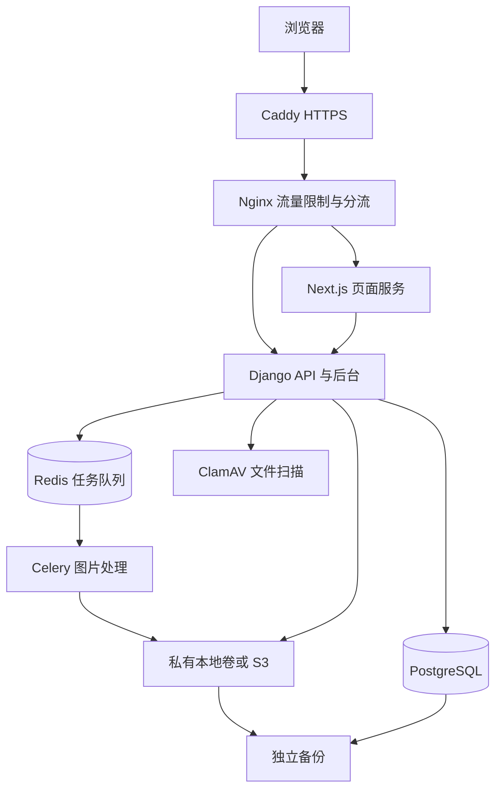
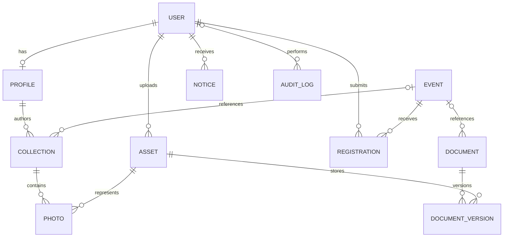

# 架构与不变量

## 部署关系

公开页面由 Next.js 服务端读取 Django 数据，成员写操作通过同源 API；登录使用 HttpOnly 会话 Cookie，写操作携带 CSRF Token。用户界面的提示不能代替后端授权。

开发时 Next.js 代理 API、后台与静态资源；正式部署 Nginx 直接将这些路径交给 Django。所有个人化响应与文件响应均 `private, no-store`，当前实现有意不使用公共 CDN 缓存图片，撤回作品会立即阻止新的网关请求。浏览器已显示的图像与已下载副本无法远程撤回。若日后增加 CDN，应先实现失效与授权方案。

## 主要实体关系

## 核心不变量

1. 每个活动与用户最多一条报名记录；取消后重新报名复用该记录。
2. PostgreSQL 事务锁定活动行后检查名额，取消操作也持有相同行锁。
3. 作品的照片不能重复关联同一文件。顺序由照片记录的 `position` 决定。
4. 资料的同一个版本号只能出现一次。API 新增版本时锁定资料条目。
5. 草稿/退回内容可编辑；提交、发布或归档后锁定。修订必须先撤回草稿。
6. 发布必须经过待审核状态；作品至少有一张处理完成的图片，资料至少有可用版本。
7. 原片不通过作品公开页面授权下载。公开展示只提供重新编码的缩略图/展示图。
8. 所有文件读请求重新检查关联内容权限；数据库不向普通客户端泄露存储键。
9. 私有作者主页的简介与届别不随公开作品返回；作品署名仍保留。
10. 文件存储键由系统生成且不可由上传者指定；本地路径必须位于存储根目录内。

## 权限模型

访客只能访问已发布且公开的内容。有效成员还可访问成员可见内容；作者可访问自己的内容；拥有对应模型编辑权限的编辑可管理该类内容。私有条目仅限作者与对应编辑。

“作品编辑”“活动负责人”“资料管理员”是全协会范围的分类管理角色。活动负责人组能管理所有活动及其报名，不是逐活动隔离角色。如需要只允许某人管理特定活动，必须增加负责人关联和对象级授权，不能只隐藏后台入口。

所有有原文件查看权限的资料管理员/作品编辑可以查看对应文件目录；不要将这些后台角色分配给普通成员。生产用户管理只交给系统管理员。

## 存储与后台任务

上传按账号锁定额度预留：单文件 25 MB、每账号累计 1 GB；额度包括历史上传。支持 JPEG、PNG、WebP、PDF、UTF-8 文本。大文件与 RAW 当前未开放。

图片在私有目录中保存原件，Celery 在数据库提交后处理图片。展示图最高 2200px，缩略图最高 700px；转换为 RGB WebP 并去 EXIF。文档在生产必须经过已配置的 ClamAV 扫描。文件处理失败有明确状态；未绑定的文件继续计入额度，避免通过反复上传绕过限制。

当前未自动清除孤立文件。清理应先列出清单、核对关联与备份，再由管理员执行；不能通过删除文章直接连带销毁原片。

## 扩展边界

器材借用应作为独立业务模块复用用户/角色，不混入活动报名表。全文检索/OCR 应独立维护索引，但权限必须回到数据库校验。Logo 替换与协会资料由后台配置，无需改动组件。
